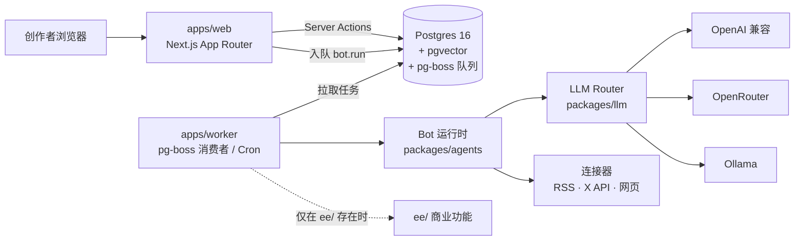

# 架构概览（v0.1）

## 一次运行的流程

1. 用户在工作台点「立即运行」（或 Routine 到点）→ 写入 `run` 表（`queued`）→ 通过 pg-boss 发送 `bot.run` 任务；
2. worker 取到任务，读取 Bot 和模板（`bot_template.spec`），按模板的 `steps` 依次执行：
   - `tool`：调用连接器 / 灵感库（`optional: true` 的工具不可用时跳过）；
   - `llm`：按档位路由到具体模型，失败时按 fallback 链切换；每次调用写一条 `usage_event`；
   - `human_review`：停止执行，运行状态变为 `awaiting_review`；
3. 每一步写入 `run_step`（Prompt、输出、token、耗时、错误），用于运行日志和调试模板；
4. 按模板 `output.kind` 落库：`draft` → `draft`（状态 `in_review`）+ `draft_version`；`topic_list` → `topic`；
5. 用户在「草稿审核」通过后才能导出 Markdown（`CC_REQUIRE_APPROVAL=true`，默认）。

## 关键设计

| 主题 | 做法 |
|---|---|
| Edition | `CC_EDITION=selfhost|cloud`，功能开关统一由 `getFeatures()` 计算；`ee/` 运行时动态加载 |
| 队列 | pg-boss（只依赖 Postgres）；`packages/core` 定义 `Queue` 接口，以后可换 BullMQ |
| 定时任务 | 每个开启的 Routine 对应一个 pg-boss schedule（队列名 `routine-<id>`），worker 每分钟同步一次 |
| 模型路由 | 模板声明档位 → `provider:model` 链 → fallback。档位来源优先级：设置页档位映射 > 设置页 Provider 凭据的档位模型（按优先级）> `CC_TIER_*`；Provider 来源：数据库 `llm_provider` 优先，环境变量兜底。预算（每个 Bot 每天 `budget_usd`）用完时降一档或暂停 |
| 计量 | `usage_event` 记录 provider、model、tier、tokens、估算费用（单价表由用户配置） |
| 密钥 | AES-256-GCM（`v1:iv:tag:ct`），主密钥 `CC_SECRET_KEY`（非演示模式必填，缺失则拒绝启动）；Provider Key 存 `secret` 表，明文从不返回前端，只显示后 4 位 |
| 登录 | 自部署单管理员：`/setup` 首次创建（advisory lock 保证只有一个），argon2id 哈希；会话 token 只存 SHA-256 到 `session` 表，30 天有效、滑动续期，cookie `cc_session`（httpOnly、SameSite=Lax）。`proxy.ts` 只做乐观检查（有无 cookie），真正的校验在服务端数据层（`authedStore` / `isApiAuthorized` / server action）。在线版的邮箱 / OAuth 登录只预留了 `account` 表和 `getAuthProviders()` 结构 |
| 演示模式 | 没有 `DATABASE_URL` 时：内存数据、无需登录、不保存 API Key，页面有明显标识 |
| Migration | Drizzle；第一个 migration 启用 `vector` 扩展；web / worker 启动时自动 migrate（advisory lock 防并发） |
| 多租户 | 所有业务表带 `workspace_id`；自部署只有一个默认 workspace；在线版再加 RLS |

## 数据模型

`workspace` · `user` · `membership` · `session` · `account` · `llm_provider` · `crew` · `bot_template` · `bot` · `routine` · `run` · `run_step` · `inspiration`（含 `embedding vector(1536)`）· `topic` · `draft` · `draft_version` · `review_comment` · `secret` · `connector_account` · `usage_event`

定义见 [`packages/db/src/schema.ts`](../packages/db/src/schema.ts)。
