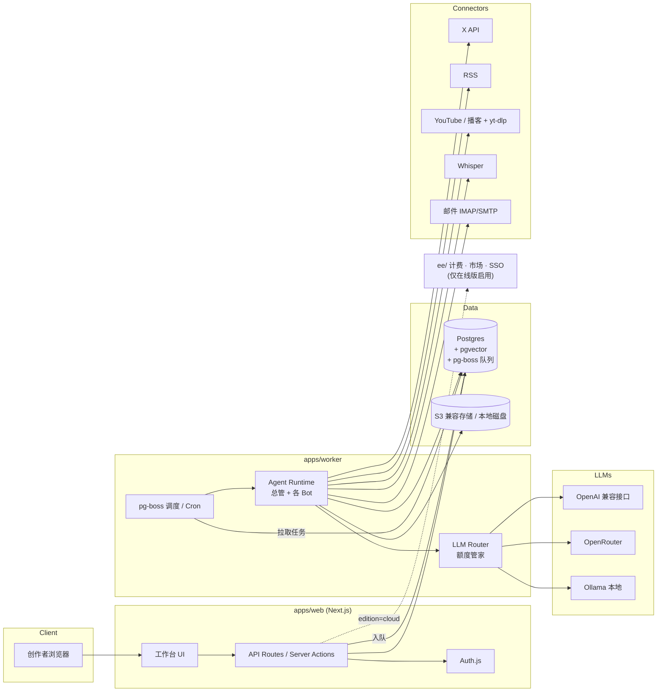

# CreatorCrew（暂定名）产品与技术方案

> 一个开源的「AI 自媒体 Agent 团队」：让 AI 内容创作者用一组可复用的 Bot 模板，完成 **选题 → 拆解 → 写作 → 分发 → 复盘** 的完整流程。
>
> - `CreatorCrew` 是**暂定名**，正式发布前需要做商标和域名检索后再定。
> - 文档版本：v0.1 草案（2026-10）
> - 技术栈：TypeScript · Next.js · Postgres（+pgvector）· Docker
> - 部署形态：**同一套代码**同时支持 ① 官方在线版（SaaS，收费）② 任何人用 Docker 一键自部署

---

## 1. 产品定位、目标用户、核心价值

### 1.1 一句话定位
**给 AI 自媒体创作者的「虚拟编辑部」**：一个总管 Bot 负责派活，多个专职 Bot 分别负责选题、拆解、写作、对标、分发、复盘和额度管理；人只做最后的判断和润色。

### 1.2 目标用户
| 用户 | 特征 | 核心诉求 |
|---|---|---|
| **A. AI 领域个人创作者**（主要用户） | 在 X / 小红书 / 公众号发 AI 工具教程、提示词合集；靠付费群（99–199 元）、品牌合作、咨询变现 | 新功能出来时**第一个**发出教程；稳定产出「保姆级 / 大全 + 可复制提示词」长文 |
| B. 小型内容团队 / MCN | 2–10 人，同时运营多个账号 | 流程标准化、多账号协作、审核流 |
| C. 动手能力强的极客 / 开发者 | 想自部署，接本地模型，自己改模板 | 数据自己掌握、可扩展、不想被平台锁定 |
| D. 模板作者 / KOL | 已经有自己的工作流（例如社区里流传的「21 个人设 Bot」） | 把工作流打包分享（让别人「抄作业」）甚至卖钱 |

### 1.3 痛点与对应价值
| 调研到的痛点 | CreatorCrew 的解法 |
|---|---|
| 想抢先发新功能教程，但信息太多、教程很快过时 | **选题雷达**定时扫描关键词和对标账号，按收藏数排序推送；灵感库给内容标注「时效」，提醒更新旧教程 |
| 灵感散落在收藏、笔记、截图里 | **灵感库**统一收集（X 书签、链接、截图 OCR、转发邮件），向量检索后可直接用来生成选题 |
| 模型账号被封、降智，访问门槛高 | **多 Provider 抽象**：自带 Key、OpenRouter、OpenAI 兼容接口、Ollama 本地模型，一个挂了能自动切到备用（**不承诺**「不封号 / 国内直连」） |
| 担心 token / 额度不够用 | **额度管家**：按任务路由模型（便宜模型做粗活，强模型做终稿），设置预算上限并告警 |
| AI 初稿仍要人工审核和润色 | 内置**人工审核流**：草稿 → 待审 → 修改 → 通过 → 导出，每个阶段可加批注 |
| 内容同质化 | **爆款对标**只拆解结构和钩子，不照抄原文；写作 Bot 引入「个人风格档案」和去 AI 味规则 |
| 同时运营多个平台很累 | **多平台分发**按 X、小红书、公众号的平台风格分别改写，输出可直接复制的内容包 |
| 想抄作业 | **模板市场**：YAML/JSON 一键导入导出，社区贡献模板 |

### 1.4 不做什么（定位边界）
- 不是通用 Agent 框架（不和 LangChain、Dify 拼通用性），专注自媒体场景。
- 不做灰产：不做批量养号、刷量、绕过平台风控。
- 不在没有官方 API 的平台上自动发帖（详见 §8）。

---

## 2. 功能范围

### 2.1 Bot / 模板系统
- **Bot = 人设 + 指令 + 工具 + 模型策略 + 输入/输出 schema**。
- **团队（Crew）**：多个 Bot 分组（参考社区案例：管事的 / 做产品的 / 做内容和增长的 / 管生活的），由**总管 Bot** 按意图把任务派给对应的 Bot，并汇总结果。
- **首批官方模板（按优先级）**：

| # | 模板 | 输入 | 输出 | 默认模型档位 |
|---|---|---|---|---|
| 0 | **总管**（调度器） | 自然语言指令 / 定时触发 | 任务分派、汇总日报 | 中 |
| 1 | **选题雷达** | X 关键词、对标账号、RSS、灵感库 | 按收藏数 / 互动排序的选题清单 + 理由 | 低（筛选）+ 中（总结） |
| 2 | **长内容拆解** | 播客 / 长视频链接或文件 | 逐字稿 → 金句 → 可直接发的推文或线程 | 低（转写用 Whisper）+ 中 |
| 3 | **长文写作** | 选题 + 素材 + 风格档案 | 去 AI 味初稿、5 个标题备选、封面图提示词 → **进入审核** | 高 |
| 4 | **爆款对标** | 爆款帖子链接 / 文本 | 结构拆解（钩子、段落节奏、CTA、提示词清单的放法） | 中 |
| 5 | **多平台分发** | 审核通过的稿件 | X 长文 / 线程、小红书图文文案 + 标签、公众号排版 Markdown | 中 |
| 6 | **涨粉复盘** | 平台数据（API 或手动导入 CSV） | 周报：涨粉、互动、收藏点赞比、Top 内容、下周建议 | 低 |
| 7 | **额度管家** | 所有 LLM 调用日志 | 用量看板、预算告警、模型路由建议 | 规则引擎（不调用 LLM） |

### 2.2 定时任务（Routines）
- Cron 表达式 + 自然语言（例如「每天 8 点扫一次」）两种配置方式。
- 触发器：定时、Webhook、灵感库有新条目、上游 Bot 完成。
- 每次运行都有记录：输入、输出、token 消耗、耗时、失败原因；失败后可以重试。
- 支持「静默期」和单个 Routine 的预算上限，防止跑飞。

### 2.3 工作台可视化面板
- **今日看板**：新选题、待审稿件、运行中的任务、今日 token 花费。
- **团队视图**：用卡片 / 组织架构图展示 Bot 分组，以及总管的调度关系。
- **内容流水线**：看板列「灵感 → 选题 → 草稿 → 待审 → 已通过 → 已发布」，可拖拽。
- **运行日志**：每一步都能看到 Prompt 和输出（方便调试模板）。

### 2.4 灵感库
- 收集渠道：浏览器书签导入、X 书签同步（API 允许范围内）、粘贴链接自动抓取正文、截图 OCR、转发到专属邮箱、Telegram/微信转发（v0.3 再考虑）。
- 自动处理：摘要、打标签、向量化（pgvector）、去重、时效标记。
- 可以作为选题雷达和长文写作的检索来源（RAG）。

### 2.5 人工审核流
- 状态机：`draft → in_review → changes_requested → approved → exported/published`。
- 段落级批注；可以「让 Bot 按批注重写这一段」。
- 版本对比（diff），并保留人工修改记录，用来持续更新**个人风格档案**（让 Bot 越写越像本人）。
- 默认规则：**任何对外发布都必须经过 approved 状态**（可配置，但默认开启）。

### 2.6 模板市场 / 导入导出
- 模板格式：`crew.yaml` / `bot.yaml`（同时支持 JSON），带 JSON Schema 校验和版本号。
- 导出时**自动剥离**密钥、私有数据和账号信息。
- 自部署版可以从 GitHub 仓库 URL 或文件导入；在线版提供市场页（评分、安装数、作者主页）。

模板示例：
```yaml
apiVersion: creatorcrew/v1
kind: Bot
metadata: { name: topic-radar, version: 0.1.0, author: official, tags: [选题] }
spec:
  persona: "你是一名 AI 领域的选题编辑，只关注可以出教程的新功能"
  model: { tier: cheap, fallback: [mid] }
  tools: [x.search, rss.fetch, inspiration.search]
  inputs:
    keywords: { type: string[], default: ["Agent", "新功能", "提示词"] }
    benchmark_accounts: { type: string[] }
  output_schema: { $ref: "./schemas/topic-list.json" }
  routine: { cron: "0 8 * * *", budget_usd: 0.5 }
```

---

## 3. 技术架构

### 3.1 Monorepo 结构（pnpm + Turborepo）
```
creatorcrew/
├─ apps/
│  ├─ web/              # Next.js（App Router）：工作台 UI + API Routes / Server Actions
│  └─ worker/           # 独立的 Node 进程：执行队列任务和定时任务（同一个镜像，用不同命令启动）
├─ packages/
│  ├─ core/             # 领域模型、Edition 配置、权限、事件总线、通用工具
│  ├─ agents/           # Bot 运行时、总管调度、模板解析/校验、官方模板
│  ├─ llm/              # LLM Provider 抽象、模型路由、用量计量
│  ├─ connectors/       # X、RSS、YouTube/播客、Whisper、邮件、存储
│  ├─ db/               # Drizzle schema、migration、pgvector
│  ├─ ui/               # 共享组件（shadcn/ui）
│  └─ config/           # eslint / tsconfig / env schema（zod）
├─ ee/                  # 商业版功能（计费、多租户管理后台、模板市场支付、SSO），独立许可证
├─ templates/           # 社区模板（YAML），通过 PR 贡献
├─ docker/              # Dockerfile、docker-compose.yml、.env.example
└─ docs/
```

### 3.2 关键技术选型
| 模块 | 选型 | 理由 |
|---|---|---|
| Web | Next.js + TypeScript + Tailwind + shadcn/ui | 已经选定；前后端一体，适合社区贡献 |
| ORM | Drizzle | 类型安全、轻量，migration 简单 |
| 数据库 | Postgres 16 + pgvector | 一个库同时承担业务数据、向量检索和任务队列 |
| 队列 / 定时 | **pg-boss**（首选） | 只依赖 Postgres，自部署少一个 Redis；自带 cron、重试、并发控制。以后量大了再在 `packages/core` 的 Queue 接口下换成 BullMQ+Redis |
| LLM | 自研薄抽象层，基于 Vercel AI SDK | 统一支持 OpenAI 兼容接口 / OpenRouter / Anthropic / Gemini / Ollama，支持流式输出和工具调用 |
| 转写 | Whisper：OpenAI API、兼容接口，或本地 faster-whisper 容器（可选） | 长内容拆解需要 |
| 媒体下载 | yt-dlp（worker 内） | 用户自己承担合规责任，并有 ToS 提示 |
| 存储 | S3 兼容（MinIO / R2 / OSS），本地磁盘作为降级 | 存截图、音频、导出包 |
| 认证 | Auth.js（Email magic link、GitHub、Google）；自部署也可以只用单个管理员账号和密码 | 在线版 SSO 放在 ee/ |
| 可观测 | 结构化日志（pino）+ OpenTelemetry（可选） | 方便排查 Bot 的运行情况 |

### 3.3 LLM 抽象与按任务路由
- **模型档位**：`cheap / mid / strong / local`。模板只声明档位，由用户在设置里把档位映射到具体模型。
- **路由规则**（额度管家负责）：
  - 筛选、分类、打标签 → cheap；终稿写作 → strong；
  - 预算用到 80% 时告警，到 100% 时自动降一档或暂停；
  - 主 Provider 报错或限流时，按 fallback 链切换（例如自带 Key → OpenRouter → Ollama）。
- **计量**：每次调用记录 provider、model、input/output tokens 和估算费用（单价表可配置，**不硬编码**）。

### 3.4 架构图


### 3.5 核心数据模型（简化）
`workspace` · `user` · `membership` · `crew` · `bot` · `routine` · `run` · `run_step` · `inspiration`（含 embedding）· `topic` · `draft` · `draft_version` · `review_comment` · `connector_account` · `secret`（加密）· `usage_event` · `template`。
所有业务表都带 `workspace_id`，为多租户做准备。

---

## 4. 自部署与在线版共用一套代码

### 4.1 Edition 配置
```ts
// packages/core/edition.ts
export const EDITION = process.env.CC_EDITION ?? "selfhost"; // "selfhost" | "cloud"
export const features = {
  multiTenant: EDITION === "cloud",
  billing: EDITION === "cloud" && hasEE(),
  marketplacePayments: EDITION === "cloud" && hasEE(),
  signup: process.env.CC_ALLOW_SIGNUP === "true" || EDITION === "cloud",
};
```
- `ee/` 目录在运行时**按需动态加载**；删掉 `ee/` 后，项目仍然能完整构建并运行（CI 中专门加一个「无 ee 构建」任务来保证这一点）。
- 功能开关统一从 `features` 读取，UI 和 API 都不直接判断 edition。

### 4.2 差异对照
| 维度 | 自部署（selfhost） | 在线版（cloud） |
|---|---|---|
| 租户 | 单租户（默认一个 workspace，可以邀请成员） | 多租户，用 `workspace_id` 隔离，再加 Postgres RLS 兜底 |
| 模型 Key | 自己提供（必须） | 自带 Key，或使用平台托管额度（计费） |
| 计费 | 无 | `ee/billing`（Stripe；国内支付方式另行评估） |
| 模板市场 | 从 Git/文件导入，可浏览公共目录 | 完整市场（付费模板、作者分成） |
| 认证 | 管理员账号 + 可选 OAuth | OAuth、Magic link、SSO（团队版） |
| 升级 | `docker compose pull && up -d`，启动时自动 migrate | 官方运维 |

### 4.3 Docker 一键部署
```yaml
# docker/docker-compose.yml（简化）
services:
  db:
    image: pgvector/pgvector:pg16
    volumes: [pgdata:/var/lib/postgresql/data]
    environment: { POSTGRES_PASSWORD: ${PG_PASSWORD} }
  web:
    image: ghcr.io/creatorcrew/creatorcrew:latest
    command: ["web"]
    ports: ["3000:3000"]
    env_file: .env
    depends_on: [db]
  worker:
    image: ghcr.io/creatorcrew/creatorcrew:latest
    command: ["worker"]
    env_file: .env
    depends_on: [db]
  # 可选 profile：minio、ollama、whisper
volumes: { pgdata: {} }
```
- 提供 `curl ... | sh` 安装脚本：自动生成 `.env`、随机 `CC_SECRET_KEY` 和数据库密码。
- 只需要 2 个必备容器（db + app）；Redis 不是必需项。
- 关键环境变量：`CC_EDITION`、`DATABASE_URL`、`CC_SECRET_KEY`（加密主密钥）、`CC_BASE_URL`、`STORAGE_DRIVER=local|s3`、`S3_*`、`X_API_BEARER`（可选）、`OPENAI_BASE_URL/OPENAI_API_KEY`（可选，也可以在 UI 中配置）。

---

## 5. 开源协议选择

| 方案 | 优点 | 缺点 | 代表 |
|---|---|---|---|
| **MIT / Apache-2.0** | 传播最快，企业接受度最高，贡献门槛最低 | 别人可以直接拿去做竞品 SaaS，原作者很难变现 | 大量 JS 库、LangChain |
| **AGPL-3.0（纯）** | 别人做 SaaS 也必须开源修改，保护在线版 | 部分公司规避 AGPL；所有代码都开源，没有专属的付费功能 | Plausible、Mastodon |
| **Open-core：AGPL 核心 + `ee/` 商业许可证** | 核心开源可自部署；计费、市场、SSO 等商业功能闭源或需要授权；双许可证还可以卖商业授权 | 需要维护两套许可证边界，需要签 CLA | Cal.com、GitLab（MIT+EE）、Dify（附加条件的 Apache-2.0 变体） |

**建议：Open-core，核心使用 AGPL-3.0，`ee/` 使用商业许可证（源码可见、生产使用需要授权），`templates/` 使用 MIT 或 CC-BY-4.0。**

理由：
1. 目标用户是个人创作者，他们自部署、自己用完全不受 AGPL 影响，传播不会受阻。
2. 防止别人直接把它包装成竞品 SaaS，保护在线版这条主要收入来源。
3. 计费、多租户后台、付费市场本来就只有在线版需要，放进 `ee/` 很自然，自部署用户不会觉得被「阉割」。
4. 模板用宽松协议，鼓励大家「抄作业」和二次分发，这是增长的关键。
5. 需要配套：贡献者签 **CLA**（例如 CLA Assistant），为以后的双授权保留可能。
6. 不建议自己改写 Apache 条款（Dify 式），因为法律解释成本高；如果以后要调整，可以评估 FSL 或 BSL 这类「延时开源」协议。

> 正式选定前，建议咨询熟悉开源协议的律师。

---

## 6. 商业化

> 以下价格**都是建议值，用来验证假设，不是市场数据**。

### 6.1 在线版套餐（建议）
| 套餐 | 建议价格 | 包含 |
|---|---|---|
| Free | 0 | 1 个 workspace、3 个 Bot、每天 1 次定时任务、只能用自带 Key、灵感库容量上限 |
| Creator | ¥49–69 / 月 | 全部官方模板、不限 Bot、每小时级的定时任务、灵感库扩容、转写时长包、少量托管额度 |
| Pro / Studio | ¥149–199 / 月 | 多账号、3 个成员席位、审核流协作、高级复盘、优先使用新模板 |
| Team | 按席位 | SSO、审计日志、私有模板库、SLA |

- 托管模型额度按量计费（按成本加成），**自带 Key 永远免费可用**。
- 定价参考对象：创作者付费群通常收 99–199 元，工具月费最好低于他们一个付费群成员带来的收入，让他们觉得「一个月就回本」。

### 6.2 模板市场
- 免费模板是主流；作者可以给模板定价，平台抽成（建议 20–30%）。
- 「认证模板作者」计划：首页曝光 + 分成，吸引已经有付费群的 KOL 把工作流产品化。
- 「模板 + 付费群」打包：作者可以给群成员发放兑换码。

### 6.3 免费与付费边界
| 免费（开源 / 自部署） | 付费（在线版 / ee） |
|---|---|
| 全部 Bot 运行时、官方模板、定时任务、灵感库、审核流、导入导出、所有 Provider | 免运维托管、托管模型额度、转写时长包、付费模板交易、多租户团队协作、SSO、优先支持 |

其他收入：企业或 MCN 的私有部署授权（ee 授权）、模板定制咨询。

---

## 7. MVP（v0.1）与路线图

### 7.1 v0.1 MVP（约 6 周）
目标：一位 AI 创作者能用它**每天拿到选题清单，并在 1 小时内产出一篇可以发的长文**。

| 周 | 里程碑 |
|---|---|
| W1 | monorepo 脚手架、Drizzle schema、Auth、Edition 配置、docker-compose 跑通 |
| W2 | LLM 抽象层（OpenAI 兼容 / OpenRouter / Ollama）、密钥加密存储、用量计量 |
| W3 | Bot 运行时 + YAML 模板解析 / 校验 + pg-boss 定时任务 + 运行日志 |
| W4 | 模板：**选题雷达**（RSS + X 搜索，X 为可选）+ **灵感库**（链接 / 粘贴 / 截图 OCR + pgvector） |
| W5 | 模板：**长文写作** + **人工审核流** + 导出 Markdown / 复制到剪贴板 |
| W6 | 工作台首页、额度看板（只读）、README / 保姆级文档、内测 10–20 位创作者 |

**v0.1 明确不做**：
- ❌ 在线版计费、多租户、模板市场（只做导入导出）
- ❌ 自动发帖到任何平台（只导出 / 复制）
- ❌ 小红书、公众号的数据抓取
- ❌ 涨粉复盘、多平台分发、爆款对标、长内容拆解（放到 v0.2）
- ❌ 移动端 App、浏览器插件、微信 / Telegram 机器人
- ❌ 总管 Bot 的自动多级调度（v0.1 只做手动串联流水线）

### 7.2 v0.2（W7–W12，约 6 周）
- 模板：**长内容拆解**（yt-dlp + Whisper）、**爆款对标**、**多平台分发**（X / 小红书 / 公众号内容包）
- **总管 Bot**：意图识别 + 派活 + 汇总日报；团队分组视图
- **额度管家**：预算告警、自动降级、fallback 链
- 模板导入导出完善（Git URL 导入、版本升级提示）
- 在线版内测：多租户 + RLS、`ee/billing` 接入

### 7.3 v0.3（W13–W20，约 8 周）
- **涨粉复盘**（X API 数据 + 其他平台 CSV 手动导入）
- 个人风格档案（从人工修改中学习）、去 AI 味规则库
- 在线版正式收费；**模板市场**上线（付费模板、作者分成）
- 灵感采集扩展：浏览器插件、邮件转发、Telegram 机器人
- 团队协作：角色权限、审计日志

---

## 8. 合规与风险

| 风险 | 说明 | 对策 |
|---|---|---|
| **X API 条款、速率限制与费用** | X API 是付费的，档位和价格变化频繁，读取额度有限；搜索和书签接口的权限取决于档位 | X 连接器设为**可选**，用户自己提供 Token；本地缓存 + 增量拉取 + 限速器；UI 显示调用量；文档说明「以 X 官方最新定价和条款为准」；没有 X API 时退回 RSS 或手动粘贴 |
| **爬虫风险** | 抓取 X、小红书等平台可能违反 ToS，导致封号或法律风险 | 官方版本**不内置**绕过登录或风控的爬虫；连接器只使用官方 API、RSS 和用户主动提供的内容；社区插件要声明风险 |
| **小红书 / 公众号没有开放的个人发帖 API** | 小红书没有面向个人的开放发布接口；公众号的接口能力受账号类型和认证限制 | 默认输出「**内容包**」（文案、标签、配图提示词，公众号用排版好的 Markdown/HTML），一键复制或下载，由用户手动发布；不做模拟点击式的自动发布 |
| **营销话术风险** | 「不封号」「国内直连」之类的说法涉及规避监管和平台规则 | **禁止**在产品、README 和推广中使用这类表述；只说「支持多个模型 Provider 和本地模型」 |
| **版权与同质化** | 爆款对标、长内容拆解可能涉及他人作品 | 对标只输出结构分析；拆解内容带上来源链接，并提示注明出处；不提供「洗稿」功能 |
| **数据隐私** | 灵感库可能包含私人笔记和截图 | 自部署时数据完全本地；在线版提供隐私政策、数据导出和删除功能，不用用户数据训练模型；面向国内用户时评估《个人信息保护法》要求 |
| **API Key 存储** | 泄露会造成用户的经济损失 | 使用 AES-256-GCM 信封加密，主密钥来自 `CC_SECRET_KEY` 或 KMS；前端只显示后 4 位；日志脱敏；导出模板时自动剥离 |
| **生成内容合规** | 在国内平台发布 AI 生成内容可能需要标识 | 导出时可以选择加上「AI 辅助创作」标识；遵守各平台的 AI 内容标注规则 |
| **在线版运营资质** | 面向中国大陆用户提供生成式 AI 服务可能涉及备案等要求 | 上线前咨询法务；初期可以只提供「自带 Key 的工具服务」，并评估服务器部署地区 |

---

## 9. 开源社区与推广

### 9.1 GitHub README 结构
1. 一句话介绍 + 30 秒 GIF（选题雷达出清单 → 一键成稿 → 审核 → 导出）
2. 「你的 AI 编辑部」团队架构图（总管 + 7 个 Bot）
3. 一键部署：`docker compose up -d`，以及在线版入口
4. 官方模板清单表格（名称、用途、截图）
5. 支持的模型 Provider 和连接器矩阵
6. 模板格式说明 + 「贡献你的模板」
7. 路线图、协议说明（AGPL 核心 / ee / MIT 模板）、Star History
8. 中英双语（中文优先）

### 9.2 X 发布计划（用创作者自己最认可的爆款格式）
- **D-7 预热**：发「我用 8 个 Bot 组了一个 AI 编辑部」的真实截图帖，征集内测用户。
- **D0 主帖**：X 长文《保姆级｜从 0 搭一个 AI 自媒体 Agent 团队（附 8 个可复制模板）》：
  - 真实运行截图（不是概念图）；
  - 每个 Bot 附上**可复制的提示词 / YAML**；
  - 结尾放 GitHub 链接 + 一键部署命令。
  - 核心指标看**收藏数**（这类内容的收藏通常比点赞多）。
- **D+1 ~ D+14**：每天拆一个模板发 listicle 帖（例如「选题雷达的 5 个关键词配置」）；同时在小红书发图文版，公众号发长文版（这些内容本身就由多平台分发 Bot 生成，顺便做演示）。
- **持续**：每当有新的 Agent 或模型功能发布，24 小时内发出「CreatorCrew 模板版」教程，强化「抢先发教程」的心智。

### 9.3 种子 KOL 与模板作者
- 邀请 10–20 位：Grok Bot 重度用户、已经公开分享 Bot 人设或工作流的创作者（例如做「21 个人设 Bot」这类内容的人）、付费群主。
- 提供：在线版免费 Pro、「认证模板作者」标识、README 和市场首页的曝光位、以后的付费模板分成。
- 请他们把自己的工作流打包成 `crew.yaml`，以「抄我的作业」的形式发布。

### 9.4 贡献机制
- `templates/` 目录接受 PR，用 CI 自动校验 schema 并检查有没有带密钥；
- 贡献者文档 + `good first issue`（新增连接器、新增模板、翻译）；
- 每月评选「模板之星」；建一个 Discord 或微信群做支持（群规中禁止灰产讨论）。

---

## 10. 下一步行动清单

| # | 行动 | 产出 | 建议时间 |
|---|---|---|---|
| 1 | 访谈 5–10 位目标创作者，验证选题雷达和长文写作两个核心场景，以及付费意愿 | 访谈纪要 + 需求优先级 | 第 1 周 |
| 2 | 检索名称、商标和域名，确定正式名称（替换 `CreatorCrew` 暂定名） | 名称决策 | 第 1 周 |
| 3 | 确认许可证方案（AGPL + ee + MIT 模板），配置 CLA | LICENSE 文件、CLA Bot | 第 1 周 |
| 4 | 初始化 monorepo、CI（含「无 ee 构建」检查）、docker-compose | 可运行的骨架仓库 | 第 1–2 周 |
| 5 | 定义 `bot.yaml` / `crew.yaml` 的 JSON Schema v1 | schema + 2 个示例模板 | 第 2 周 |
| 6 | 核实 X API 当前档位、价格和可用接口，确定选题雷达的数据源方案 | 连接器技术备忘 | 第 2 周 |
| 7 | 按 §7.1 推进 MVP 开发，每周用真实账号「自己吃自己的狗粮」 | v0.1 | 第 1–6 周 |
| 8 | 招募种子 KOL，准备发布用的保姆级长文和截图素材 | 种子名单 + 发布素材 | 第 4–6 周 |
| 9 | 在线版合规咨询（隐私政策、AI 服务相关要求、支付） | 合规清单 | 第 5–8 周 |
| 10 | v0.1 发布，收集反馈，规划 v0.2 | 发布复盘 | 第 6–7 周 |
